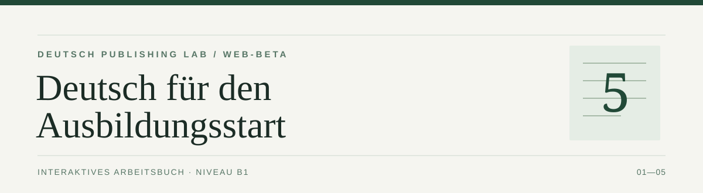

<p align="center">
  
</p>

# Deutsch für den Ausbildungsstart

**Ein interaktives B1-Arbeitsbuch rund um Bewerbung, Ausbildungsbetrieb und Berufsschule.**

*Deutsch Publishing Lab · Web-Beta · Kostenloser Lernprototyp*

Dieses Projekt erprobt, wie sich berufsbezogene Deutschübungen in einer übersichtlichen, browserbasierten Lernumgebung präsentieren lassen. Fünf Kapitel begleiten Lernende von Stellenanzeigen bis zur Berufsschule. Inhalte und Prüfungsansprüche werden bewusst vorsichtig formuliert: Das Produkt ersetzt weder offiziellen Sprachunterricht noch eine anerkannte B1-Prüfung.

## Das Lernprodukt im Überblick

| Kapitel | Thema | Schwerpunkt |
| :--- | :--- | :--- |
| 01 | Stellenanzeigen | Anforderungen und Aufgaben verstehen |
| 02 | Anschreiben | Formulierungen und Motivation |
| 03 | Vorstellungsgespräch | Berufliche Erfahrungen und Fragen |
| 04 | Ausbildungsbetrieb | Arbeitsanweisungen und Rückfragen |
| 05 | Berufsschule | Lernorganisation und Kommunikation |

**Umsetzung:** responsives HTML/CSS/JavaScript, ohne Framework oder Build-Schritt. Die interaktive Oberfläche verwendet browserseitige Speicherung für den Lernfortschritt und Entwürfe, soweit der Browser dies zulässt.

## Vorschau und lokaler Start

- [Quellcode der Anwendung](index.html)
- [Browser-Qualitätstests](tests/browser_qa.py)
- [Editorial Quality Gate](docs/EDITORIAL_QUALITY_GATE.md)
- [Market Validation v1](docs/MARKET_VALIDATION_V1.md)

Zum lokalen Test:

```bash
git clone https://github.com/eldeville1-hue/deutsch-publishing-lab.git
cd deutsch-publishing-lab
python3 -m http.server 8000
```

Danach `http://localhost:8000/` öffnen. Die Seite kann statisch über GitHub Pages aus `main` veröffentlicht werden.

## Qualität und transparente Grenzen

- Automatisierte Browser-Tests sind eingerichtet; ein erfolgreicher Lauf ersetzt keine Prüfung auf einem physischen iPhone.
- Geschlossene Fragen werden automatisch ausgewertet; bei freien Texten helfen Checklisten und Modelltexte zur Selbstkontrolle.
- Lernfortschritt und Entwürfe können im Browser gespeichert werden. Der Fortschrittsexport umfasst den Kapitelstand, nicht sämtliche frei geschriebenen Texte.
- Eine **unabhängige DaF/DaZ-Fachprüfung** von Lernzielen, Aufgaben und Bewertungskriterien steht noch aus.
- Der aktuelle Prototyp erhebt **keine Zahlungen**.

Die offenen Freigabekriterien und redaktionellen Verbesserungsbedarfe sind im [Quality Gate](docs/EDITORIAL_QUALITY_GATE.md) dokumentiert.

## Portfolio: Was dieses Projekt demonstriert

**Frontend engineering** — Gestaltung und Umsetzung einer responsiven Lernoberfläche, interaktiver Aufgaben und lokaler Zustandsverwaltung.

**Product thinking** — Lernpfad und inhaltliche Struktur für eine konkrete Zielgruppe im Kontext Ausbildung.

**Quality assurance** — Automatisierte Browser-Regressionen, nachvollziehbare Freigabekriterien und dokumentierte Grenzen der Validierung.

**Status:** Web-Beta. Die fünf Kapitel sind eine erste, noch nicht unabhängig didaktisch zertifizierte Fassung. Langfristige Erweiterungen werden erst nach inhaltlicher Validierung priorisiert.

---

<sub>Ein unabhängiges Projekt von [eldeville1-hue](https://github.com/eldeville1-hue). Die visuelle Präsentation ist Teil einer konsistenten Portfolio-Gestaltung; der Quellcode der Lernanwendung wurde für diese Dokumentationsänderung nicht angepasst.</sub>
